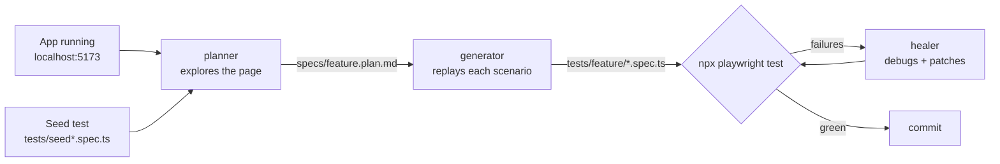

# Smart Start — Playwright UI tests with test agents

TypeScript Playwright tests for the Smart Start Student Portal, written with Playwright's AI test agents. The same
three agents are set up twice, once for each tool:

| Agent | What it does | Output |
|---|---|---|
| **planner** | Explores the running app in a browser and writes a test plan | `specs/<feature>.plan.md` |
| **generator** | Replays each plan scenario live in a browser and writes the test | `tests/<feature>/*.spec.ts` |
| **healer** | Runs the tests, debugs failures in the browser and patches them | edited specs |

| Tool | Agent definitions | MCP server config |
|---|---|---|
| Claude Code | `.claude/agents/*.md` | `.mcp.json` |
| GitHub Copilot (VS Code) | `.github/agents/*.agent.md` | `.vscode/mcp.json` (and inline in each agent file) |

Both talk to the browser through Playwright's `playwright-test` MCP server (`npx playwright run-test-mcp-server`).

Covered so far: login — `specs/login.plan.md` → 10 tests in `tests/auth/`.

## How the flow works



1. **Seed** — every agent session starts by running a seed test to put the browser in a known state.
   `tests/seed.spec.ts` opens `/login`; `tests/seed-authenticated.spec.ts` signs in and lands on `/dashboard`.
   Use the authenticated seed for any page behind login.
2. **Plan** — the planner opens the seed page, clicks through the feature and saves a Markdown plan: numbered
   scenarios, each with steps, expected results, a seed and a target file name (see `specs/login.plan.md`).
3. **Review the plan** — read it before generating. Remove scenarios that would touch real student data, and make
   sure negative login scenarios use a throwaway username.
4. **Generate** — the generator takes one scenario at a time, performs each step in a real browser, then writes a
   one-test file from what it actually did, using the locators it saw.
5. **Heal** — the healer runs the suite, steps into each failure, inspects the page and fixes selectors, waits or
   assertions. If a test can't be fixed it is marked `test.fixme()` with a comment explaining why.
6. **Tidy up** — move repeated locators into a page object in `pages/` (e.g. `pages/LoginPage.ts`), then run
   `npx playwright test` and `npx tsc --noEmit`.

## Setup

```bash
# 1. app running (from repo root)
docker compose up -d

# 2. this folder
cd playwright-agents
npm install
npx playwright install chromium
```

Credentials come from `ADMIN_USERNAME` / `ADMIN_PASSWORD` in the repo-root `.env`
(override with `TEST_USERNAME`, `TEST_PASSWORD`, `BASE_URL`). Tests import them from `support/env.ts` — never
hard-code the password.

## Running tests

```bash
npm test                 # headless
npm run test:headed      # watch the browser
npm run test:ui          # Playwright UI mode
npm run test:pending     # only @pending tests (features not built yet; skipped by npm test)
npm run typecheck        # tsc --noEmit
npm run report           # open the last HTML report
```

## Writing tests for a new flow with Claude Code (`.claude/agents`)

Claude Code picks up the agents in `.claude/agents/` and the MCP server in `.mcp.json` from the folder it starts in,
so **start it from this folder**:

```bash
cd playwright-agents && claude
```

Approve the `playwright-test` MCP server when asked. Check with `/mcp` (server connected) and `/agents` (three
`playwright-test-*` agents listed). `CLAUDE.md` is loaded automatically and gives the agents the project rules
(throwaway usernames, `data-testid` locators, no `waitForTimeout`, don't touch real data).

Example — adding tests for a **Students** page:

**1. Plan**

> Use the playwright-test-planner agent to create a test plan for the Students page: add a student, edit, search,
> deactivate. Seed: `tests/seed-authenticated.spec.ts`. Only create students with a unique name prefix like
> `E2E-` and never edit existing ones. Save to `specs/students.plan.md` with files under `tests/students/`.

**2. Generate** (one section at a time keeps runs short and reviewable)

> Use the playwright-test-generator agent to generate the tests for section 1 of `specs/students.plan.md`.

You can ask for several sections at once; Claude runs one generator per scenario.

**3. Heal**

> Use the playwright-test-healer agent to run the tests in `tests/students/` and fix the failing ones.

**4. Refactor and verify**

> Move the Students locators into `pages/StudentsPage.ts`, update the tests to use it, then run
> `npx playwright test` and `npx tsc --noEmit`.

Tips:
- Say "use the … agent" explicitly; otherwise Claude may do the work itself without the browser tools.
- Generated tests follow what the generator saw on screen. If the page has no `data-testid` for an element, it falls
  back to roles/text — consider adding a test id in the app instead.
- If an agent can't reach the app, check `docker compose ps` and that `BASE_URL` is right.

## Writing tests for a new flow with GitHub Copilot (`.github/agents`)

The `.github/agents/*.agent.md` files are the same three agents as Copilot custom agents. Each one declares the
`playwright-test` MCP server itself, and `.vscode/mcp.json` registers it for VS Code too.

1. Open this folder (`playwright-agents`) as the VS Code workspace so `.github/` and `.vscode/` are at the root.
2. Open `.vscode/mcp.json` and click **Start** on the `playwright-test` server (or run *MCP: List Servers*).
3. Open Copilot Chat, switch to **Agent** mode and pick the agent from the agent dropdown:
   `playwright-test-planner`, `playwright-test-generator` or `playwright-test-healer`.
4. Send the same prompts as in the Claude Code section, without the "Use the … agent" part, e.g. with the
   planner selected:

   > Create a test plan for the Students page (add, edit, search, deactivate). Seed:
   > `tests/seed-authenticated.spec.ts`. Save to `specs/students.plan.md`.

   Then switch to the generator for each section, then the healer.
5. Copilot does not read `CLAUDE.md`. Paste the rules that matter into your prompt (or add a
   `.github/copilot-instructions.md`): throwaway usernames for failed logins, `getByTestId` first, don't edit data
   you didn't create.

The agents' `model:` is set to `Claude Sonnet 4.6`; change it in the frontmatter if your Copilot plan offers a
different model.

`.github/workflows/copilot-setup-steps.yml` prepares the environment for the **Copilot coding agent** on github.com
(installs dependencies and browsers). The app is not running there, so planner/generator runs from github.com won't
reach `localhost:5173` unless the workflow also starts it. Its last step (`npx run build`) is a placeholder from
`init-agents` — replace it with whatever starts the app, or remove it.

## Feature not built yet (test-first from a requirement)

The planner and generator need a running page. For an unbuilt feature, tests are written from a written requirement
instead and tagged `@pending` (skipped by `npm test`, run with `npm run test:pending`):

1. Copy `requirements/_TEMPLATE.md` to `requirements/<feature>.md` and fill it in.
2. Ask Claude to write `specs/<feature>.plan.md` (including a **UI Contract** of routes, `data-testid`s and messages,
   plus **Open Questions**), a page object in `pages/`, and one test per scenario in `tests/<feature>/` tagged
   `@pending`.
   `CLAUDE.md` refers to a custom `playwright-test-requirements` agent for this, but its definition is not in
   `.claude/agents/` yet — until it's added, ask the main Claude session directly.
3. Give the UI Contract to whoever builds the feature so the tests match it, and answer the Open Questions.
4. Once it's built: `npm run test:pending`, then use the healer on the `@pending` tests. It may fix selectors and
   timing, but must not weaken an assertion that encodes the requirement — it reports the mismatch instead.
5. When they pass, remove the `@pending` tags so they join the normal run.

## Test overlay (email, SMS, Ask assistant)

Tests that send email/SMS or use the Ask assistant must run with the backend in test mode, so nothing reaches real
parents. From the repo root:

```bash
docker compose -f docker-compose.yml -f docker-compose.e2e.yml up -d backend   # before
docker compose up -d backend                                                   # after
```

This routes email to MailHog (http://localhost:8025), SMS to `stubs/sms-sink` (http://localhost:8090/messages) and
the assistant to `stubs/fake-ollama`. Back up the database first if tests create data (see `../RUNNING.md`).

## Rules for every test

- **Never fail a login with the real admin username** — 5 failures lock it for 15 minutes. Use
  `throwawayUsername()` from `support/env.ts`.
- Prefer `getByTestId(...)`, then roles/labels. No CSS/XPath, no `waitForTimeout`.
- Tests must be independent and parallel-safe. Don't delete or edit data you didn't create — the database holds the
  centre's real students.

## Updating the agents

After upgrading `@playwright/test`, regenerate the agent definitions:

```bash
npx playwright init-agents --loop=claude    # .claude/agents + .mcp.json
npx playwright init-agents --loop=vscode    # .github/agents + .vscode/mcp.json
```

This overwrites Playwright's own agent files, so re-apply any local edits (e.g. the Copilot `model:`) afterwards.
